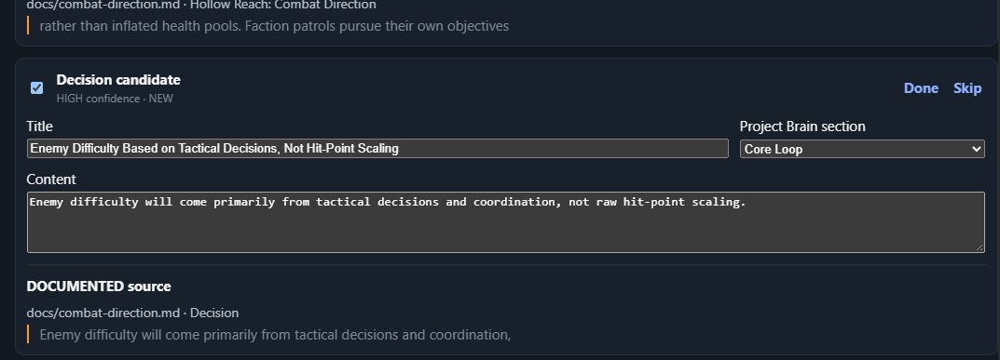
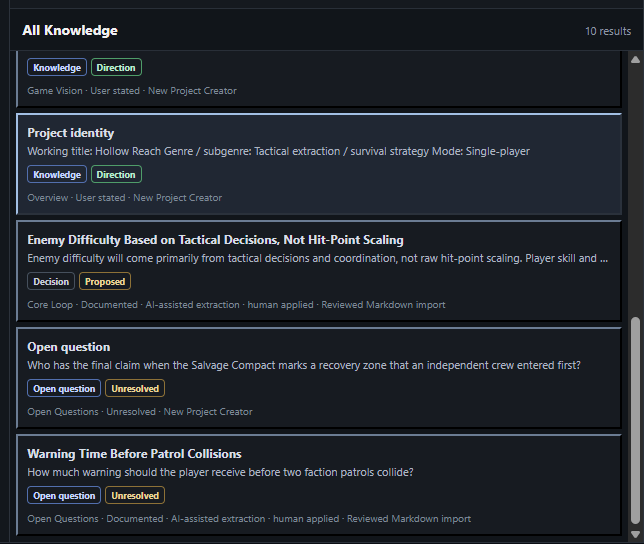
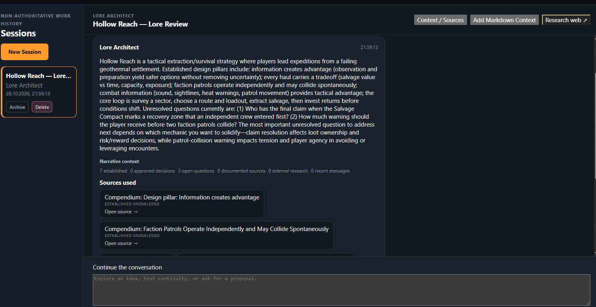
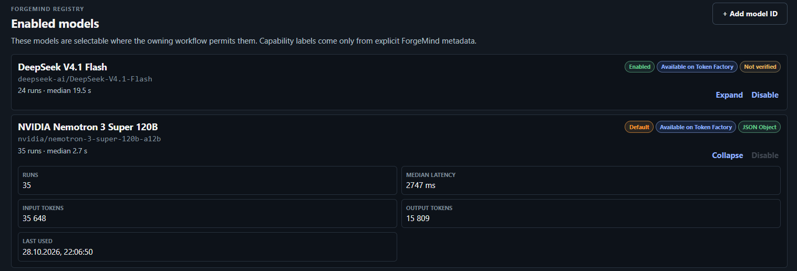

# ForgeMind

**AI for Game Development**

**Turn ideas into playable worlds.**

**A source-aware AI workspace that keeps game design intent, implementation reality, and AI output aligned.**

Game projects scatter truth across design documents, team conversations, Git, Unity, and AI output. ForgeMind turns those sources into a reviewable **Project Brain** without allowing temporary AI output to silently become project truth.

The fastest way to see it:

```text
Markdown
-> NVIDIA Nemotron extracts candidates through Nebius Token Factory
-> a human reviews, edits, and explicitly applies selected knowledge
-> Game Wiki reflects the updated Project Brain
-> Writers' Room reasons over that source-aware context
-> optional Tavily research remains visibly external
```

Imported Markdown remains `DOCUMENTED`, Decisions begin `PROPOSED`, Open Questions remain unresolved, and Writers' Room conversation stays non-authoritative until a human applies a reviewed proposal through its owning domain.

**INTENT ↔ REALITY ↔ ALIGNMENT**

ForgeMind is a local-first desktop workspace for indie developers, small game teams, technical designers, narrative designers, and teams already using AI in game development.

## Download / Try ForgeMind

ForgeMind is available as a prebuilt Windows test release. Download the latest hackathon build from [GitHub Releases](https://github.com/tybek/ForgeMind/releases); the recommended release is **ForgeMind v0.1.0-hackathon**.

- Windows desktop build; no source build is required to launch the packaged release.
- No API credentials are included in the public build.
- Live Nebius Token Factory / NVIDIA Nemotron and Tavily workflows require credentials supplied by the person testing them.
- Local and read-only areas can be inspected without exposing developer credentials.
- The public demo video shows the complete reviewed AI workflow using Nebius Token Factory, NVIDIA Nemotron, and Tavily.

## The problem

AI makes it easier to generate ideas, but it can make a game's source of truth harder to maintain. A useful suggestion in one chat can contradict an approved design decision, drift away from the code, or be mistaken for implemented behavior.

ForgeMind connects reviewed design intent, durable decisions, repository evidence, Unity evidence, and bounded AI workflows while preserving where every claim came from and who has authority to apply it.

## The ForgeMind loop

```text
INTENT ↔ REALITY ↔ ALIGNMENT
```

- **Intent** is the game the team has agreed to build: its vision, design direction, narrative, constraints, and approved decisions.
- **Reality** is bounded evidence of what currently exists in Git and Unity.
- **Alignment** records whether selected evidence is `ALIGNED`, `UNVERIFIED`, `OUT_OF_SYNC`, or in `CONFLICT` with intent.

AI helps extract, compare, and propose. Humans decide what becomes durable. ForgeMind does not autonomously edit the game, approve AI output, or replace Git, Unity, an IDE, or a coding agent.

## The 30-second workflow

```text
Existing Markdown
-> Nebius / Nemotron extracts knowledge candidates
-> a human reviews, edits, and applies selected candidates
-> Game Wiki reflects the owning Project Brain domains
-> Writers' Room reasons over that updated, source-aware context
-> optional Tavily research stays visibly external
```

An imported statement is not automatically canon. A Decision candidate starts `PROPOSED`; an Open Question remains unresolved; Markdown-derived knowledge keeps `DOCUMENTED` provenance. Git and Unity evidence can then be compared with intent without being rewritten by the AI workflow.



*NVIDIA Nemotron extracts review candidates; nothing enters Project Brain until the developer explicitly applies it.*

## What it does

ForgeMind currently provides:

- a local-first project workspace with Project Overview, Game Design, Decisions, Game Wiki, and Open Questions;
- review-first Markdown Knowledge Import;
- a source-aware Writers' Room for lore, characters/dialogue, and continuity;
- explicit Tavily web research that remains separate from established project knowledge;
- read-only Git Reality and portable Unity GroundTruth evidence;
- human-reviewed Alignment and Feature Contracts;
- dynamic Nebius Token Factory model discovery with an application-local capability registry and observed metrics; and
- source-aware navigation back to the domains that own project truth.

## Project Brain and authority

Project Brain is a logical aggregate over existing owning domains, not a second database. Game Wiki is a read-only projection; there is no `wiki.json`.

```text
Conversation
-> Proposal
-> Human review / edit
-> Explicit Apply
-> Owning domain
-> Project Brain
```

AI conversation and proposals are non-authoritative. External research remains `EXTERNAL_RESEARCH`. Selected Markdown begins as `DOCUMENTED`. Decisions require their own approval lifecycle. This boundary lets AI help without quietly changing the game's durable direction.



*Applied knowledge retains `DOCUMENTED` provenance, AI-assisted extraction, and human review.*

## Knowledge Import

Knowledge Import supports 1-10 explicitly selected, project-contained Markdown files:

```text
Markdown
-> NVIDIA Nemotron through Nebius Token Factory
-> Project Knowledge / Proposed Decision / Open Question candidates
-> Review, edit, select
-> Apply through Compendium or Decisions
```

Speculative language is rejected from durable Knowledge rather than normalized into fact. The review queue is transient, selected items are revalidated before Apply, and exact duplicates are skipped. Import is Markdown-only; it is not a general document-ingestion, repository-crawling, or canon-generation system.

## Writers' Room

Writers' Room is a source-aware collaborative AI workspace with three current profiles:

- **Lore Architect** for worldbuilding, factions, locations, history, cultures, and conflicts;
- **Character & Dialogue** for characters, motivations, relationships, voice, scenes, and dialogue; and
- **Continuity Editor** for established, documented, unresolved, conflicting, and missing narrative context.

Each request uses bounded, deterministic Project Brain context and shows a source trace. Conversation remains work history, not project truth. Where a durable proposal is available, the flow is **Review/Edit -> Accept -> Apply**.



*Writers' Room reasons over reviewed Project Brain knowledge with visible source traces.*

### Tavily external research

The user can explicitly choose **Research web** to make one bounded Tavily Basic Search. Returned snippets are reviewed and selected before they may enter a later Writers' Room request. They remain `EXTERNAL_RESEARCH`, structurally distinct from `ESTABLISHED` and `DOCUMENTED` project sources.

Tavily retrieves external patterns; NVIDIA Nemotron compares selected research with the project's existing direction. There is no autonomous search, hidden query rewriting, automatic retry, or automatic promotion into project truth.

## Reality and Alignment

- **Git Reality** uses fixed, read-only inspection commands to expose branch, HEAD, working-tree, changed-file, diff-stat, and recent-commit evidence.
- **Unity GroundTruth** uses a separate editor-only exporter to create portable, project-relative evidence with explicit coverage limits.
- **Alignment** compares selected intent with selected evidence and produces `ALIGNED`, `UNVERIFIED`, `OUT_OF_SYNC`, or `CONFLICT`, followed by a separate human review state.

Git and Unity evidence are read-only. Component or file presence does not prove runtime behavior, and incomplete coverage is not treated as evidence of absence.

## AI and provider architecture

### Nebius Token Factory

Nebius Token Factory is ForgeMind's current inference provider behind a replaceable native Rust boundary. It powers explicit AI workflows, dynamic model-catalog refresh, and privacy-minimized local usage observations. Provider calls are never made on startup and are not retried automatically.

### NVIDIA Nemotron

The current default structured-output model is **NVIDIA Nemotron 3 Super 120B A12B**:

```text
nvidia/nemotron-3-super-120b-a12b
```

ForgeMind uses it for Writers' Room structured responses, Markdown Knowledge Import extraction, New Project Creator proposals, Feature Contract drafting, and other implemented structured workflows. These are task-specific uses, not a claim that Nemotron is universally best.

## Model Catalog

ForgeMind explicitly refreshes the models currently listed by Nebius Token Factory, then keeps provider discovery separate from its local registry:

- **Available** means Token Factory listed the model during the latest successful refresh.
- **Enabled** means the model is available for explicit selection in ForgeMind.
- **Verified capability** records only capabilities confirmed in the local registry.
- **Custom** identifies a bounded model ID added locally rather than discovered.

Availability does not establish structured-output support, pricing, quality, or task suitability. Discovered and custom models default to **Structured output: Not verified**. Structured workflows block an incompatible model locally before provider execution.

Observed run count, median latency, input/output token totals, and last-used time are installation-local observations—not benchmark rankings or automatic routing signals.



*Nebius Token Factory model discovery is separate from ForgeMind-verified structured capability.*

## Architecture

```text
React / TypeScript UI
        |
        | narrow Tauri commands
        v
Rust native domains
  |-- local .forgemind JSON stores
  |-- read-only Git / Unity evidence boundaries
  |-- Nebius Token Factory provider adapter
  `-- Tavily Search adapter
```

React has no generic filesystem, shell, or network capability. The native layer owns project validation, file access, credentials, outbound requests, normalization, and safe errors. Project-owned data remains portable under `.forgemind/`; model registry, catalog cache, and usage observations are application-local.

See [Architecture](docs/ARCHITECTURE.md) and [Workflows](docs/WORKFLOWS.md) for the detailed contracts.

## Built With

- **Nebius Token Factory** - inference, model discovery, and provider-reported usage for explicit AI workflows.
- **NVIDIA Nemotron 3 Super 120B A12B** - the default model for implemented structured proposal and extraction workflows.
- **Tavily Search** - explicit, user-reviewed external research inside Writers' Room.
- **Tauri 2** and **Rust** - the desktop/native trust boundary and local persistence.
- **React**, **TypeScript**, and **Vite** - the desktop UI.
- **Vitest** and **React Testing Library** - deterministic frontend validation.
- **Git** and **Unity GroundTruth** - read-only implementation evidence.
- **Local-first JSON stores** - portable project truth and review history.

## Getting started

### Prerequisites

- Node.js LTS and npm
- Rust with the stable toolchain
- platform prerequisites from the [Tauri 2 setup guide](https://v2.tauri.app/start/prerequisites/)
- on Windows: the stable MSVC toolchain, Microsoft C++ Build Tools, and WebView2

The current development and release-validation baseline is Windows desktop. See [Current limitations](#current-limitations).

### Install and run

```powershell
git clone <your-fork-or-repository-url>
cd ForgeMind/app
npm install
npm run tauri dev
```

For frontend-only development, run `npm run dev` from `app/`.

### Configuration

Live Nebius workflows require `NEBIUS_API_KEY` in the environment of the process that launches ForgeMind. Tavily is optional unless you use **Research web**.

```powershell
$env:NEBIUS_API_KEY = "<your-key>"
$env:TAVILY_API_KEY = "<your-key>"
npm run tauri dev
Remove-Item Env:NEBIUS_API_KEY
Remove-Item Env:TAVILY_API_KEY
```

ForgeMind does not load `.env` files. Never commit keys or place them under `.forgemind/`. The [application development notes](app/README.md) include a PowerShell secure-input example.

### Validation

From `app/`:

```powershell
npm run check
npm run test:native
npm run build
npm run tauri build -- --no-bundle
```

Automated tests use mocks and offline fixtures. They do not make provider calls. See [Validation Policy](docs/VALIDATION.md).

## Security and privacy

- project state is local-first and project-owned data stays under `.forgemind/`;
- Nebius and Tavily credentials are read only by native provider adapters;
- credentials, authorization headers, raw provider bodies, and hidden reasoning are not persisted in project files;
- provider requests are explicit and bounded;
- external research is treated as untrusted data; and
- durable AI-assisted changes require human authority gates.

These are bounded, best-effort safeguards, not a universal security guarantee or complete prompt-injection defense. See [Security and Privacy](docs/SECURITY_AND_PRIVACY.md) and the [Final Security Audit](docs/FINAL_SECURITY_AUDIT.md).

## Current limitations

- Knowledge Import accepts Markdown only; PDF, DOCX, chat, and generic repository ingestion are not implemented.
- The implemented Writers' Room context is deterministic and bounded, not vector search, embeddings, or general semantic retrieval.
- Tavily research is explicit and manual, not autonomous or multi-query research.
- Only models with an explicitly verified structured-output capability can run structured workflows.
- Provider availability and reliability remain external dependencies; ForgeMind does not infer quality or pricing from catalog discovery.
- There is no general Task Router, automatic model recommender, or automatic model fallback.
- Wiki Chronicler and the broader ForgeMind Studios roadmap are not implemented.
- Git Reality and Unity GroundTruth are read-only evidence integrations.
- The current UX and release-validation baseline are desktop-focused and Windows-tested; broader distribution remains future work.

ForgeMind fails closed on malformed structured output, invalid source references, unsafe paths, and incompatible model capabilities instead of silently promoting uncertain output.

## Status and roadmap

ForgeMind is feature frozen for the hackathon submission. The public-repository security gate is `PUBLIC_RELEASE_READY`; the public-safe screenshots and final demo video are complete, and the remaining work is release publication, final links, fresh-clone QA, and submission—not product feature development.

See the [Roadmap](docs/ROADMAP.md), [Hackathon Submission Readiness](docs/HACKATHON_SUBMISSION.md), [Devpost draft](docs/DEVPOST_SUBMISSION_DRAFT.md), and [DEMO-0 runbook](docs/DEMO_RUNBOOK.md).

## Hackathon

ForgeMind was built for the **Nebius x NVIDIA Global AI Hackathon**. The submission centers on one story: AI can help a game team reason faster without allowing temporary output to silently replace reviewed project truth.

The public-safe demo workspace is **Hollow Reach**. The reviewed screenshot set and its public-safe filenames are documented in [docs/assets](docs/assets/README.md); no screenshot is fabricated or committed as a placeholder.

## License

ForgeMind is open-source software under the [MIT License](LICENSE).
