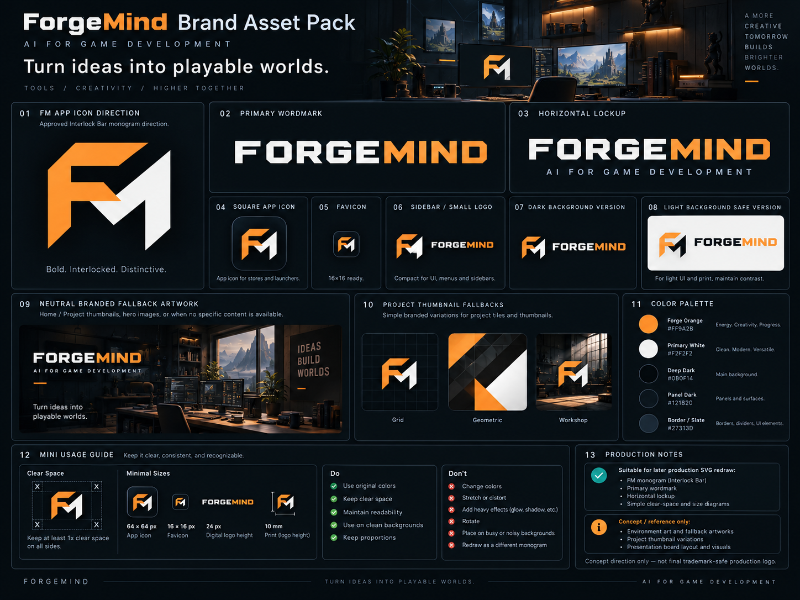
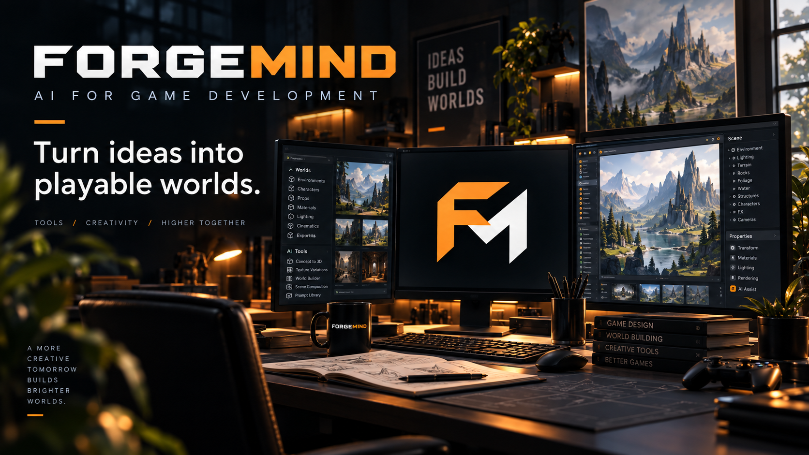
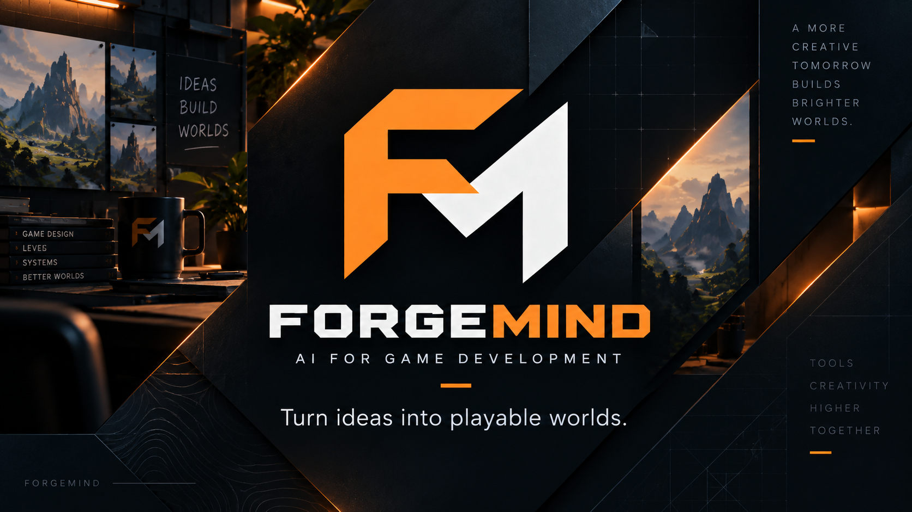
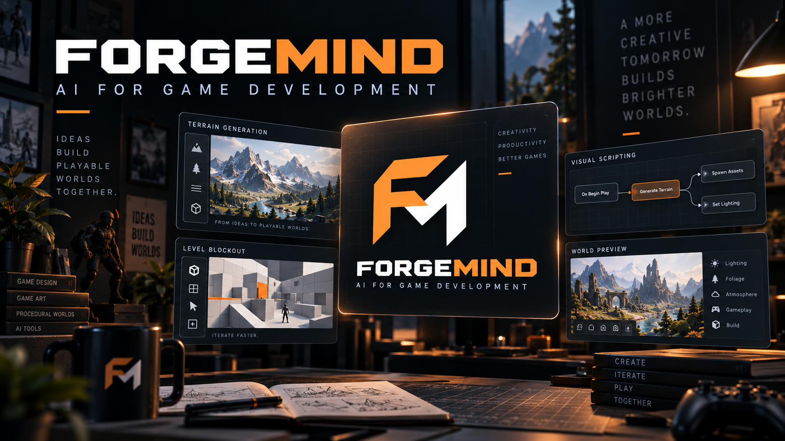

# ForgeMind Brandbook

## Status and relationship

This document records the agreed ForgeMind brand foundation and the bounded UI-1 integration state. It does not claim that the website, app icon, or reference images are final production assets.

**UI-1 COMPLETE.** The application uses the core palette, semantic presentation tokens, shared typography/surface/control patterns, restrained shell styling, and production SVG brand assets. The UI-1 manual visual pass is recorded in [Validation](VALIDATION.md). UI-2 and later phases have not started. See [ForgeMind UI Direction](UI_DIRECTION.md) for dashboard behavior, information architecture, artwork use inside the application, and phased status.

## Concept / visual-direction references

The images below are **concept and visual-direction references**, not application assets, trademark-safe vector artwork, or implemented UI specifications. Generated mockups must not be treated as pixel-accurate UI requirements. The controlled SVGs in `app/src/assets/brand/` are the application-facing source assets; they use original, manually maintained geometry rather than traced or mechanically vectorized reference pixels. Product implementation should follow this Brandbook together with [ForgeMind UI Direction](UI_DIRECTION.md), preserve existing product behavior and authority boundaries, and use the PNG boards only to understand the intended atmosphere and hierarchy.

### Brand system reference



### Product and dashboard mood references







## Brand essence

**Name:** ForgeMind

**Descriptor:** AI for Game Development

**Primary statement:** Turn ideas into playable worlds.

ForgeMind is an AI workspace that helps teams reason, align, and build better games. It supports game developers; it does not position AI as replacing them.

The brand should express a workshop, control room, and creative studio: capable, focused, modern, practical, creative, technical without sterility, premium without corporate polish, and native to real game development.

## Messaging hierarchy

### Primary

- **AI for Game Development**
- **Turn ideas into playable worlds.**

### Supporting

- From game vision to implementation.
- Keep intent, decisions and reality aligned.
- Your game. Always in context.
- Build with clarity.
- More clarity. Better decisions. Stronger games.

Use supporting lines selectively. Do not stack multiple slogans in one small product surface.

### Positioning guardrail

ForgeMind is **AI-assisted infrastructure for understanding, designing, reviewing, and implementing a game coherently**.

ForgeMind is not “AI that makes your game for you.” Avoid exaggerated claims such as “unleash infinite creativity,” “revolutionary AI magic,” “fully autonomous game creation,” or “build anything instantly.”

## Brand identity

### Primary wordmark

The preferred wordmark treatment is:

- **FORGE** in Primary White;
- **MIND** in Forge Orange;
- **AI FOR GAME DEVELOPMENT** as an optional subtitle where space permits.

The wordmark should feel geometric, technical, slightly industrial, and intentional without becoming excessively futuristic.

### FM monogram

The preferred app icon is an original geometric **FM** monogram:

- **F** in Forge Orange;
- **M** in Primary White;
- deep dark or near-black background.

The monogram should carry the identity without a brain, game controller, robot, hammer, sparkle, or other literal symbol.

### Required configurations

1. FM app icon.
2. ForgeMind wordmark.
3. ForgeMind wordmark with descriptor.

The monogram should remain legible at application-icon, sidebar, favicon, and watermark sizes.

The production source configurations are:

- `app/src/assets/brand/forgemind-mark.svg` — compact FM mark on a deep-dark tile;
- `app/src/assets/brand/forgemind-wordmark.svg` — font-independent FORGE/MIND vector wordmark;
- `app/src/assets/brand/forgemind-lockup.svg` — horizontal mark and wordmark lockup.

The descriptor remains live application text beside the lockup so it stays readable and accessible. Use the mark alone for compact icon surfaces, mark plus wordmark in the sidebar, and the full lockup plus descriptor on pre-project surfaces. Do not use the concept PNGs as runtime assets. Operating-system executable icon rasterization and packaging remain a separate follow-up.

### Minimum-size direction

- FM app icon: approximately 24 px minimum in product UI; the sidebar currently gives it more room for recognition.
- Wordmark: approximately 120 px minimum before removing the descriptor; use the mark alone below that threshold.
- At small sizes, remove the descriptor before compromising wordmark legibility.

These are starting guidelines for UI-1 validation, not finalized print-production specifications.

### Originality and legal safety

The logo must remain an original ForgeMind identity. Do not copy, trace, or closely imitate external trademarks, game logos, studio marks, product icons, or commercial identities. Generated visual references are inspiration only and are not approved production assets.

## Color system

### Core palette

- **Forge Orange — `#FF9A2B`**: primary CTA, active navigation, key brand accent, selected emphasis, `MIND` wordmark, and `F` in the FM monogram.
- **Primary White — `#F2F2F2`**: primary text, `FORGE` wordmark, and `M` in the FM monogram.
- **Deep Dark — `#0B0F14`**: application base and icon background.
- **Panel Dark — approximately `#121820`**: cards and working surfaces.
- **Border Slate — approximately `#27313D`**: restrained borders, dividers, and quiet structure.

Forge Orange should be recognizable but scarce. Do not flood the interface with orange or use it for every heading, border, and icon.

### Semantic colors

Brand accent and semantic state have different jobs:

- **Green:** success, aligned, complete, healthy connection.
- **Amber:** warning, attention, unverified.
- **Red:** out of sync, destructive, failure, error.
- **Restrained purple or blue:** AI, analysis, and informational states.

Do not turn dashboards into a rainbow. Use semantic colors consistently, pair them with text, and reserve strong saturation for meaningful state or action.

## Typography

### Wordmark and display

Use a geometric, technical, slightly industrial treatment with enough width and spacing to feel deliberate. Avoid novelty typefaces, military styling, and exaggerated sci-fi forms.

### Application UI

Prefer a highly readable modern sans serif. Suitable direction includes families similar to Inter, Geist, and IBM Plex Sans. Do not store or distribute proprietary font files unless licensing explicitly permits it.

### Hierarchy

The system should clearly distinguish:

- page title;
- section title;
- card title;
- body copy;
- metadata;
- provenance and status labels.

Reserve all caps primarily for eyebrow labels, small categories, provenance, and short metadata. Avoid paragraphs, long buttons, or large blocks of uppercase text.

## Iconography

Use one consistent icon family with:

- simple line construction;
- approximately 1.5–2 px visual stroke;
- modern, slightly technical character;
- restrained detail;
- consistent optical size and alignment.

Possible concepts include:

- Overview: home or dashboard;
- Game Wiki: book or document;
- Decisions: document with check;
- Alignment: target, link, or alignment metaphor;
- AI Studio: subtle abstract analysis or spark form;
- Repository: branch or repository;
- Unity: the appropriate integration mark only when legally acceptable;
- Feature Contracts: document or checklist;
- Settings: gear.

Do not mix emojis, random Unicode symbols, filled and outlined styles, or icons from unrelated families. Primary navigation should retain text labels rather than depending on icon recognition alone.

UI-1 uses one internal dependency-free line-icon component with a `1.75px` stroke, `24px` view box, rounded joins/caps, and text labels for navigation and unfamiliar actions. Future icons should extend that component or replace the complete set through one explicitly chosen licensed family; pages must not introduce competing icon packages or Unicode action glyphs.

## Product surfaces

Use a Deep Dark base, slightly lighter Panel Dark surfaces, subtle Border Slate structure, minimal shadow, and moderate corner radius. Hierarchy matters more than decoration.

Avoid placing every text fragment in its own visible box. A card should usually express one purpose, one main state or value, and one primary action.

### Button system

- **Primary:** Forge Orange background with dark readable text.
- **Secondary:** dark surface, light border, light text.
- **Destructive:** red only for genuinely destructive actions.
- **Tertiary:** text or icon button with clear focus and hover treatment.

Do not place multiple visually primary buttons in one local action area.

### Status badges

Use compact, consistent badges or pills for states such as:

- Approved;
- Draft;
- Pending Review;
- Aligned;
- Unverified;
- Out of Sync;
- AI Generated;
- Verified from Unity;
- Verified from Git;
- Deprecated;
- Superseded.

Use the same semantic color meaning across all workspaces and always retain the textual state.

## Tone of voice

ForgeMind copy is concise, direct, calm, confident, practical, and non-hype. It should sound like a competent game-development collaborator.

Preferred examples:

- Review what changed.
- Continue building.
- 2 alignment issues need attention.
- Draft an implementation-ready contract.
- Refresh Unity Reality.
- Review AI proposal.

Avoid exclamation-heavy marketing, anthropomorphic magic, promises of instant completion, or language that diminishes the developer's authorship.

## Product vocabulary

Prefer:

- Project Brain;
- Game Wiki;
- Decisions;
- Reality;
- Alignment;
- AI Studio;
- Feature Contract;
- Implementation Brief;
- Specialist;
- Evidence;
- Review;
- Approve;
- Continue Building.

Avoid excessive use of “magic,” “autopilot,” “genius,” “fully autonomous,” and “copilot.” Use established domain terms consistently rather than inventing new labels for visual novelty.

## AI branding principle

AI should not visually or conceptually overpower ForgeMind. It may appear as a specialist, analyst, drafting assistant, reviewer, evaluator, or planning assistant.

AI presentation should:

- identify suggestions and inference clearly;
- preserve source facts and evidence labels;
- keep human apply, save, promote, and approve actions explicit;
- avoid glowing omnipresent “AI mode” decoration;
- avoid presenting generated output as project truth.

## Artwork direction

### Product artwork

The application should prefer user-selected project covers, user-uploaded concept art, actual game screenshots, future Unity-derived screenshots, and neutral ForgeMind branded fallbacks—in that order. Do not present random generated fantasy art as if it belongs to a user's project.

Home may be more emotional and cinematic, with dark focused atmosphere and warm orange highlights. Editing workspaces should become progressively more functional and less decorative.

### Marketing artwork

Marketing may combine:

- dark cinematic backgrounds;
- ForgeMind Orange;
- the ForgeMind wordmark;
- real product UI;
- game-development workspaces or environments.

The core story is:

```text
Ideas
-> Context
-> Decisions
-> Reality
-> Alignment
-> Implementation
-> Playable Game
```

Do not tell the story as “Prompt -> AI -> finished game.”

## Motion

When introduced, motion should be subtle, quick, and functional—approximately 150–250 ms for fades, short slides, state changes, and local feedback.

AI execution may show a local spinner, progress, and elapsed time where useful. Avoid excessive glow, dramatic thinking animations, looping decoration, or movement that delays interaction. Respect reduced-motion preferences.

## Brand review checklist

Before approving a branded surface or asset, confirm:

- it feels game-development native without resembling esports UI;
- Forge Orange is focused rather than dominant;
- semantic colors retain their meaning;
- the FM monogram and wordmark remain original and legible;
- typography is readable and appropriately licensed;
- icons come from one coherent family;
- copy is calm, direct, and free of AI hype;
- AI remains an assistant to human judgment;
- product artwork is truthful to the user's project;
- visual hierarchy makes the next useful action obvious.
